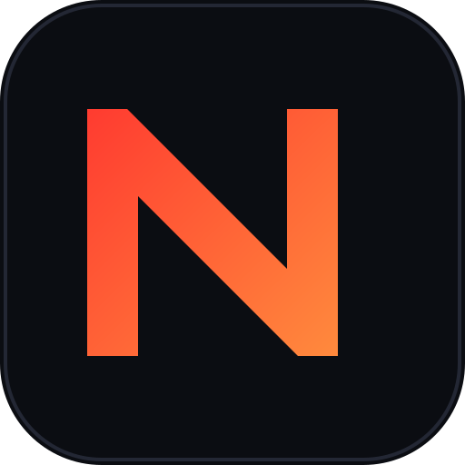
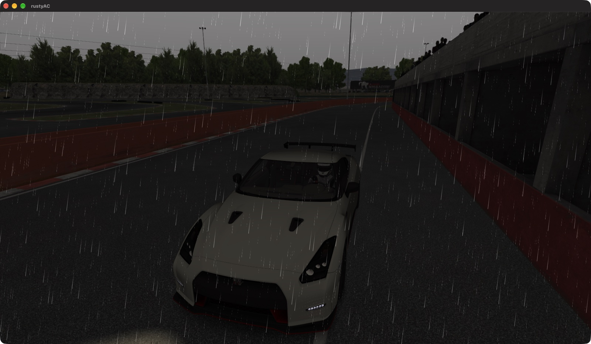
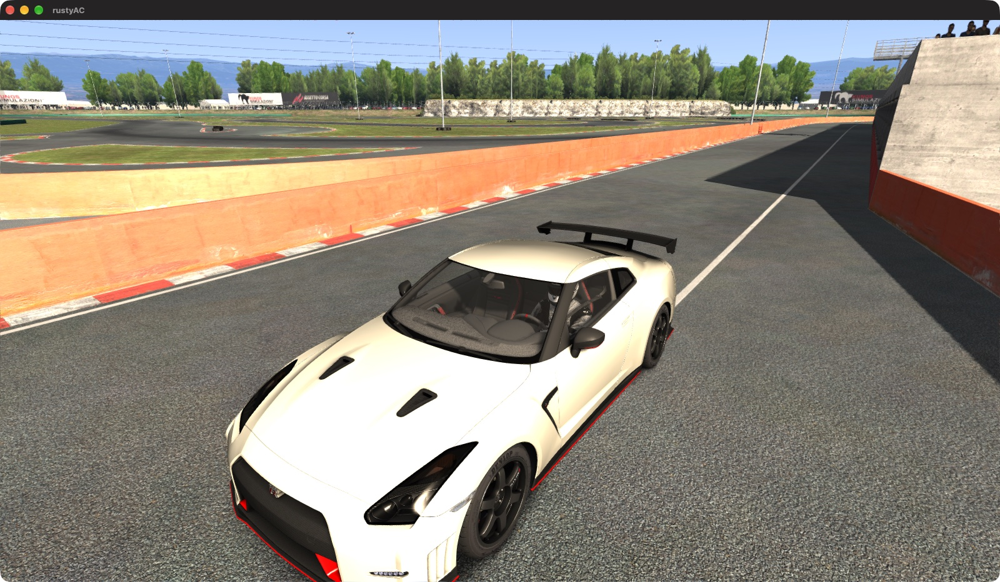
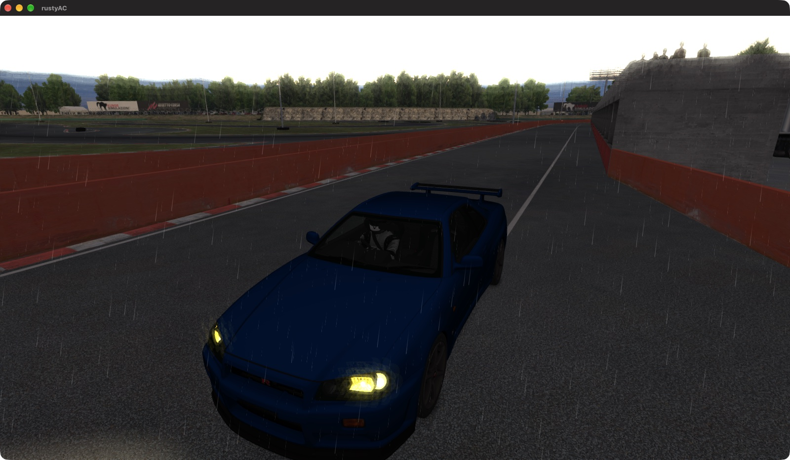
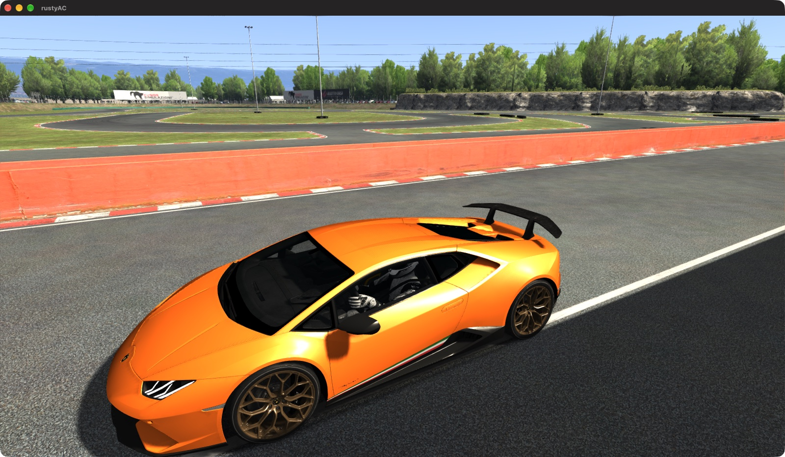
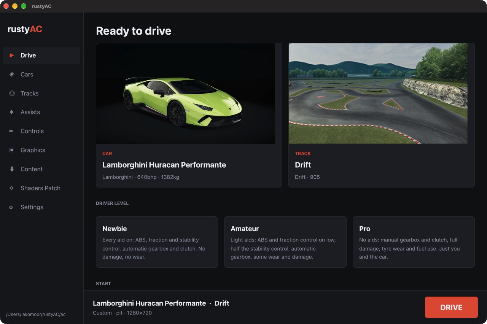

<div align="center">



# neoAC

**Assetto Corsa, native on macOS and Linux.**

Rust · wgpu (Metal / Vulkan) · own launcher · own sound mixer · no Wine, no emulation

[](https://lakomoor.github.io/neoAC/)
[](https://github.com/LakoMoor/neoAC/actions)
[](LICENSING.md)



</div>

> [!NOTE]
> **Built on [rustyAC](https://github.com/thesupersupersigma/rustyAC)** by thesupersupersigma, the open-source Rust rewrite of Assetto Corsa. neoAC is not a fork of a game and not a new engine: the physics, renderer and most of the code are rustyAC's, with licenses and notices kept. rustyAC's own README: [docs/RUSTYAC_README.md](docs/RUSTYAC_README.md).
>
> Not affiliated with Kunos Simulazioni or 505 Games. No game files are included: you need your **own legal copy of Assetto Corsa 1.16**.

## Screenshots

| | |
|---|---|
|  |  |
|  |  |

## What neoAC adds

| | |
|---|---|
| 🖥️ **Mac and Linux build** | double-click start (`rustyac.command` / `rustyac.sh`) |
| 🚀 **Launcher** | cars, tracks, skins, assists, graphics, weather, time, grip, mods from a zip, Shaders Patch page |
| 💡 **Lights from the model** | headlight pools and lamp colours from each car's `lights.ini` and meshes; soft turn-on |
| 🌧️ **Rain and wet roads** | rain fixed in the world, grip from the track state |
| 🎥 **Chase camera** | right button orbits and stays (double click resets), wheel zooms |
| 🚶 **Walk out of the car** | **F**, first person, GTA style |
| 🛠️ **Debug panel** | **F10**: frame times, telemetry, tyre contacts, brightness, detail distance |
| 🔊 **Own sound mixer** | the game's sound banks without FMOD |
| 🧪 **Data tests** | every car's `.ini` parses; power and weight agree with the spec sheet |

## Status

**Works:** driving on macOS with the original renderer, HUD and menus (keyboard and mouse), launcher, lights, rain, walking, joining a Kunos `acServer` on the LAN.

**Not yet:** Linux (compile-checked only), gamepad, Python apps, turn signals (the base game has none), exact sound, hosting a server from the game.

## Run it

You need [Rust](https://rustup.rs) and your Assetto Corsa 1.16 folder (`content` and `system`).

```sh
git clone https://github.com/LakoMoor/neoAC
cd neoAC
export AC_ROOT="/path/to/assettocorsa"

# straight into a car
cargo run --release -p rustyac-native -- --car ks_nissan_gtr --track drift

# or package the launcher into the game folder, then double-click rustyac.command
sh packaging/package_unix.sh "$AC_ROOT"
```

Useful options: `--weather <preset>` `--hour <0-23>` `--grip <0.4-1>` `--orbit <yaw>,<pitch>[,<dist>]` `--debug-panel` `--shot <png>`. See `--help`.

## License

GPL-3.0-or-later for the game, physics, renderer, sound and launcher; some parts MIT OR Apache-2.0 or BSD-3-Clause. See [LICENSING.md](LICENSING.md). Screenshots show Assetto Corsa content and belong to their owners.
